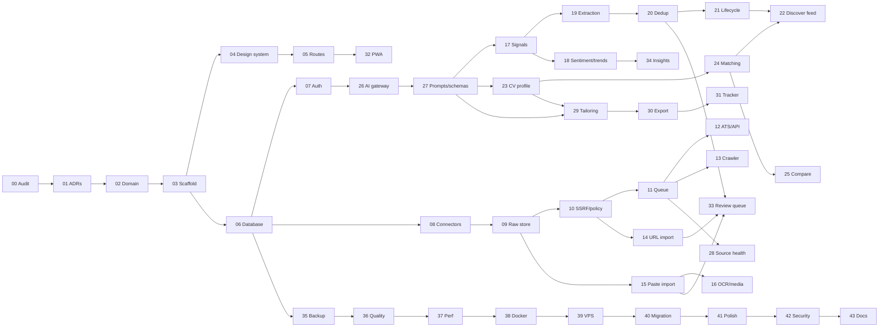

# Unjobless — Implementation Roadmap

Derived from `docs/UNJOBLESS_BUILD_PLAYBOOK.md` and the audit in `docs/PROJECT_AUDIT.md`. One prompt block = one reviewed, tested, semantic commit.

---

## 1. Epics

| Epic | Blocks | Outcome |
|---|---|---|
| E0 Foundations | 00, 01, 02, 03 | Audit, architecture ADRs, domain model, scaffold |
| E1 Shell & data | 04, 05, 06, 07 | Design system, routes, schema/migrations, private auth |
| E2 Safe collection core | 08, 09, 10, 11 | Connector contract, raw evidence store, SSRF/policy guards, queue/scheduler |
| E3 AI foundation | 26, 27 | Provider gateway, encrypted keys, versioned prompts/schemas |
| E4 Ingestion | 12, 13, 14, 15, 16 | ATS/API connectors, crawler, URL + paste import, OCR/media |
| E5 Intelligence | 17, 19, 20, 21, 18 | Signal detection, extraction, dedup, lifecycle, sentiment/trends |
| E6 Personal decisioning | 23, 24, 22, 25 | CV profile, matching, discover feed, two-vacancy compare |
| E7 Apply | 29, 30, 31, 33 | Tailoring, export, tracker, review queue |
| E8 Operations & insight | 28, 34, 35, 32 | Source health, career intelligence, backup/export, PWA |
| E9 Hardening & release | 36, 37, 38, 39, 40, 41, 42, 43 | Quality gates, performance, Docker, VPS, migration, polish, security, docs |

## 2. Dependency graph

## 3. Ordering issues found in the playbook sequence

The playbook says to run blocks in numeric order but also to stop when a prerequisite is missing. Inspection shows these forward dependencies:

| Block | Depends on later block | Problem | Recommendation |
|---|---|---|---|
| 16 Multimodal, 17 Signals, 19 Extraction, 23 CV profile | **26/27 AI gateway & prompts** | All use structured AI outputs; the gateway doesn't exist until 26. | **Move 26 and 27 to run right after 11.** Alternatively build 17/19 deterministic-first with an AI port stubbed, then retrofit — more rework. |
| 22 Discover feed | **24 Matching**, 23 Profile | Feed requires "best profile fit" sort and match-score filter. | Run 23 → 24 → 22, or build 22 with the match sort/filter disabled and enable it in 24. |
| 14 URL import | 19 Extraction, 33 Review | Item states "extracted / needs review" need an extractor and review UI. | Acceptable: in 14 store raw + basic metadata; full review lands in 33. Document the interim state. |
| 21 Lifecycle vs 18 Sentiment | — | 18 is independent of vacancy lifecycle. | Run 18 after 21 so vacancy work is contiguous. |
| 38 Docker (late) | used from 06 onward | Postgres/Redis are needed locally from Block 06. | In 03/06 add a **dev-only** compose file for Postgres/Redis; full app containerisation stays in 38. |
| 36 CI (late) | lint/test from 03 | Quality gates should start early. | Add a minimal CI workflow in 03 if a Git remote exists (decision D6). |

These are recommendations; the owner decides (audit decision D2). No block content changes — only order.

## 4. Proposed build order (small blocks)

| Phase | Order | Gate before next phase |
|---|---|---|
| 0 Foundations | 00 → 01 → 02 → 03 | ADRs approved; scaffold installs cleanly from lockfiles |
| 1 Shell & data | 04 → 05 → 06 → 07 | Migrations from empty DB pass; auth boundary tests pass |
| 2 Safe collection | 08 → 09 → 10 → 11 | **Review architecture + security foundation** (playbook recommends pausing here); SSRF suite green |
| 3 AI foundation | 26 → 27 | Mocked-provider tests green; key never returned by API |
| 4 Ingestion | 12 → 13 → 14 → 15 → 16 | Fixture-only connector/crawler tests; partial batch failure handled |
| 5 Intelligence | 17 → 19 → 20 → 21 → 18 | Evaluation set with precision/recall; no fabricated fields |
| 6 Personal | 23 → 24 → 22 → 25 | Compare rejects ≠2 IDs at API; scores reproducible |
| 7 Apply | 29 → 30 → 31 → 33 | Master CV unchanged after tailoring; exports open |
| 8 Ops & insight | 28 → 34 → 35 → 32 | Backup restores into clean env |
| 9 Release | 36 → 37 → 38 → 39 → 40 → 41 → 42 → 43 | No unresolved critical security findings |

## 5. MVP cut (playbook §27)

First useful personal release = phases 0–4 (minus 16), plus 17, 19, 20, 21, 22, 23, 24, 25, 29, 30, 33, 35, 38. Deferrable without blocking the MVP: 16 (OCR/media), 18 and 34 (sentiment/insights), 28 (rich health dashboard — basic status from 11 suffices), 32 (PWA install polish), social-platform connectors.

## 6. Status (2026-11-16)

All blocks 00–43 are implemented in the re-sequenced order of §4: AI foundation (26–27) right after the collection core, and 23 → 24 → 22. Defaults chosen where the owner had not decided:

| Decision | Default taken |
|---|---|
| D1 stack | Python (FastAPI + Procrastinate) + React/Vite PWA, Postgres-only (ADR 0001) |
| D2 re-sequencing | Applied |
| D3 AI provider | Anthropic adapter (default `claude-opus-5-5`) + generic OpenAI-compatible adapter; optional |
| D4 VPS | ≥ 2 vCPU / 4 GB, amd64 or arm64 |
| D5 language | English UI; documents in Indonesian or English |
| D6 CI | GitHub Actions workflow included |
| D7 first sources | Greenhouse, Lever, Ashby connectors + career-page crawler; owner adds boards |
| D8 off-server backups | Documented rsync/copy; destination is the owner's choice |
| D9 scholarships | Class exists, separate from vacancies |

Open follow-ups: [KNOWN_LIMITATIONS](release/KNOWN_LIMITATIONS.md).
