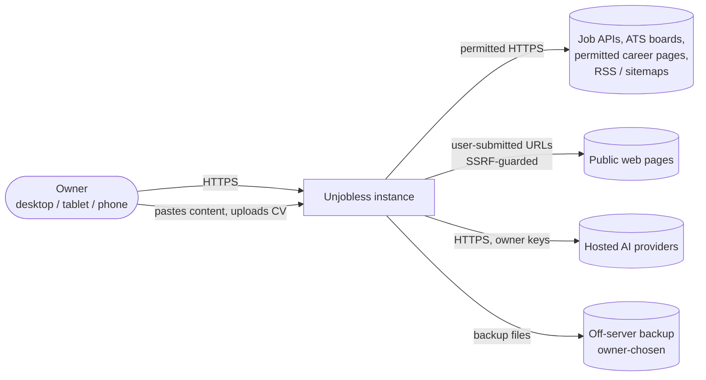
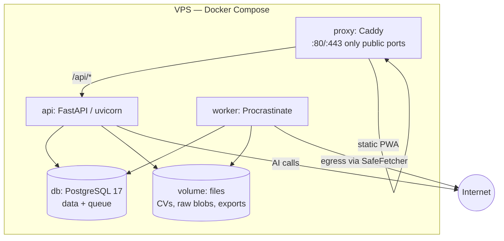
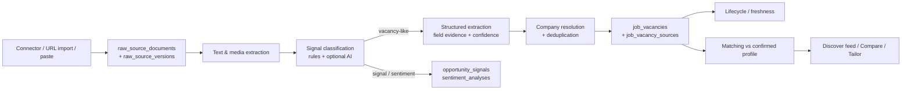

# Unjobless — Architecture

Status: **Accepted** (Block 01, 2026-11-16). Decisions are recorded in [`ADRs/`](ADRs/).

## 1. Summary

Unjobless is a **modular monolith** with one domain codebase in Python and a separate TypeScript single-page PWA:

| Container | Tech | Responsibility |
|---|---|---|
| `proxy` | Caddy 2 | TLS, HTTPS redirect, security headers, serves the built PWA, reverse-proxies `/api` |
| `api` | Python 3.13, FastAPI, SQLAlchemy 2, Pydantic 2 | HTTP API, auth, domain services |
| `worker` | Same Python package, Procrastinate worker | Collection, imports, parsing, AI tasks, scheduled jobs |
| `db` | PostgreSQL 17 | System of record **and** job queue (no Redis) |
| `web` (build-time only) | React 19 + TypeScript + Vite + vite-plugin-pwa | Built to static files copied into `proxy` |

`api` and `worker` are the same Python package (`unjobless`) started with different commands. They share models, repositories, connectors and the SSRF-safe fetcher. There are no microservices.

## 2. System context



## 3. Containers



Networks: `edge` (proxy↔api) and `internal` (api, worker, db; `internal: true` for db). Only `proxy` publishes ports. The worker needs egress; SSRF protection is enforced in-process by the `SafeFetcher` (ADR 0003). An optional headless-browser service, if ever added, gets its own network with no route to `db`.

## 4. Data flow



Raw content is never modified after storage; every derived record carries a reference back to the raw version and evidence spans.

## 5. Repository layout

```
apps/web/            React + Vite PWA (TypeScript)
backend/             Python package `unjobless` (api + worker), Alembic migrations, tests
  src/unjobless/
    core/            config, logging, errors, security primitives
    db/              SQLAlchemy models, session, repositories
    domain/          enums, state machines, pure domain logic
    api/             FastAPI routers and schemas
    sources/         connector contract, registry, connectors
    fetch/           SafeFetcher (SSRF guard), robots, rate limits
    ingestion/       raw store, URL/paste import
    intelligence/    signals, extraction, dedup, lifecycle, sentiment
    profile/         CV ingestion, profile, matching, comparison
    ai/              provider gateway, prompts, schemas
    applications/    tailoring, export, tracker
    jobs/            Procrastinate app, tasks, schedules
deploy/              Caddyfile, compose overrides, scripts
docs/                product, architecture, domain, design, ops
```

## 6. Selected versions (checked 2026-11-16 against PyPI / npm)

| Component | Version | Why |
|---|---|---|
| Python | 3.13 | Installed locally; supported by every selected library |
| FastAPI | 0.163 | Typed, async, OpenAPI, mature |
| SQLAlchemy / Alembic | 2.1 / 1.20 | Standard ORM + versioned migrations |
| psycopg | 3.3 | Postgres driver used by SQLAlchemy and Procrastinate |
| Pydantic / pydantic-settings | 2.14 / 2.16 | Validation at trust boundaries, env config |
| Procrastinate | 3.11 | Postgres-backed queue: retries, periodic tasks, locks, actively maintained |
| httpx + dnspython | 0.28 / 2.9 | HTTP client with transport hooks; explicit DNS resolution for SSRF checks |
| selectolax, trafilatura | 1.0 / 2.3 | Fast HTML parsing; maintained readable-content extraction |
| pypdf, python-docx | 7.1 / 1.2 | CV text extraction and DOCX export |
| cryptography, argon2-cffi | 50 / 25 | Fernet/AES-GCM key encryption; password hashing |
| structlog | 26.1 | Structured JSON logs with redaction processors |
| uv | 0.13 | Lockfile-based Python dependency management |
| Node / pnpm | 26 / 11 | Installed locally; pnpm lockfile for the PWA |
| React / Vite / vite-plugin-pwa | 19.3 / 8.3 / 2.0 | Mainstream SPA + PWA tooling |
| TypeScript | 6.0 | 7.x (native compiler) is newest, but 6.0 has the broadest lint/tooling compatibility; revisit later |
| PostgreSQL | 17 | Current stable major in official images |
| Caddy | 2 | Automatic HTTPS, simple config |

## 7. Cross-cutting rules

- All scraped/pasted content is **data, never instructions** (prompt-injection defence, ADR 0004).
- Secrets come from environment only; AI keys are stored encrypted with `UNJOBLESS_MASTER_KEY` (ADR 0004).
- Logs are structured JSON; a redaction processor strips keys, cookies, auth headers and CV text.
- Every background job is idempotent (deterministic queueing locks / idempotency keys).
- Missing data is `null`/unknown everywhere — never zero, never inferred silently.
