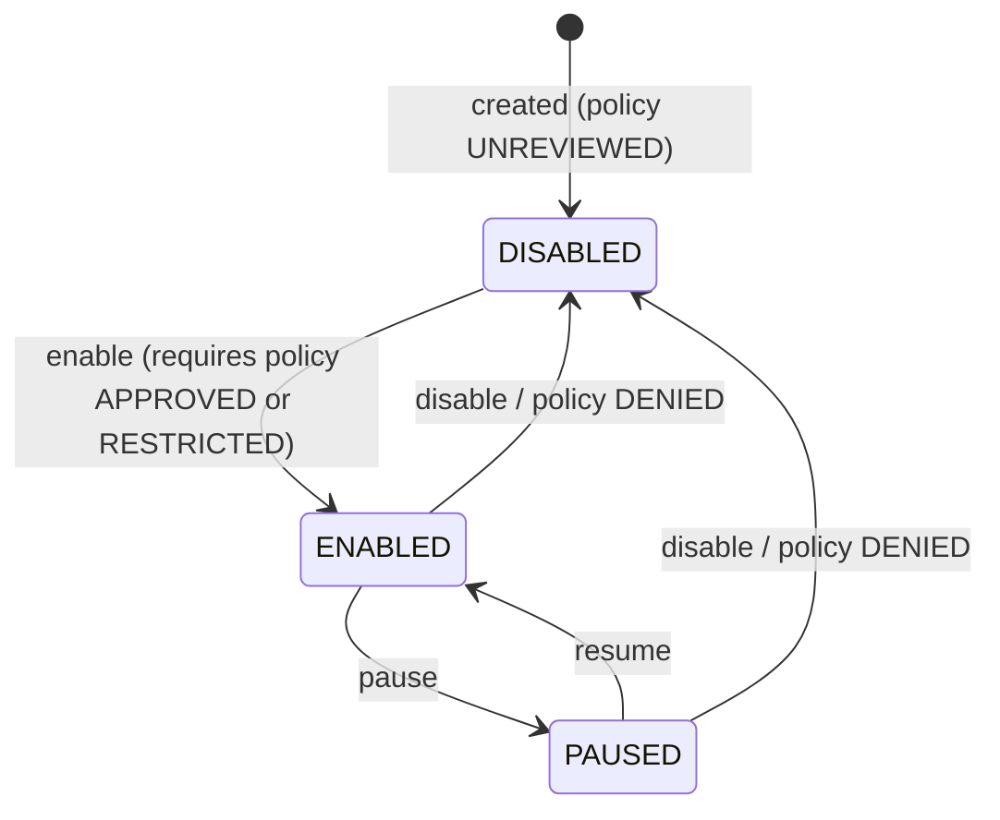
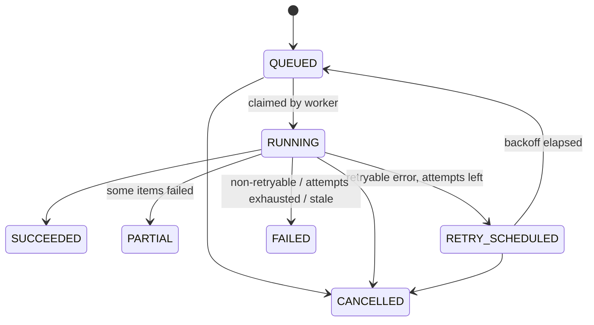
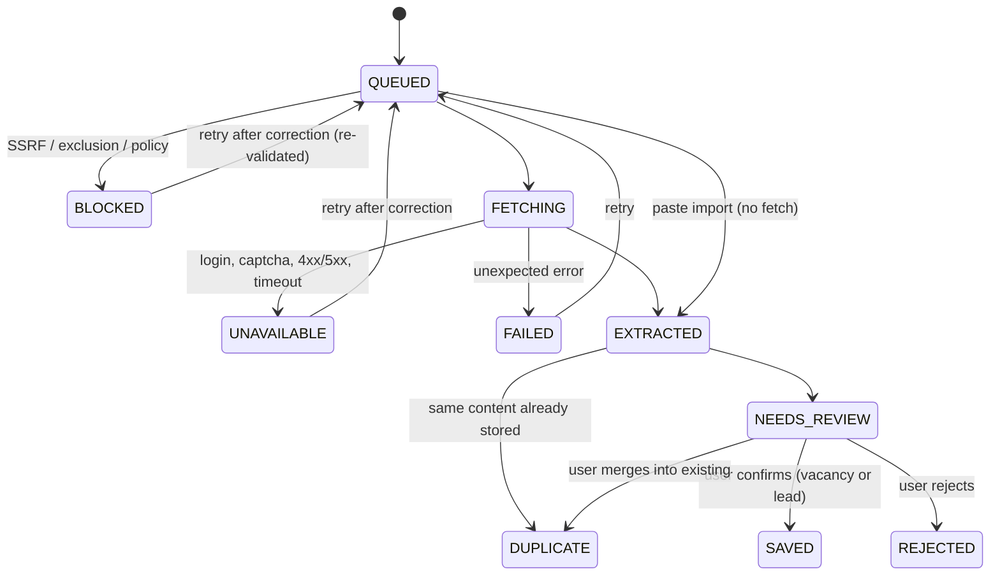
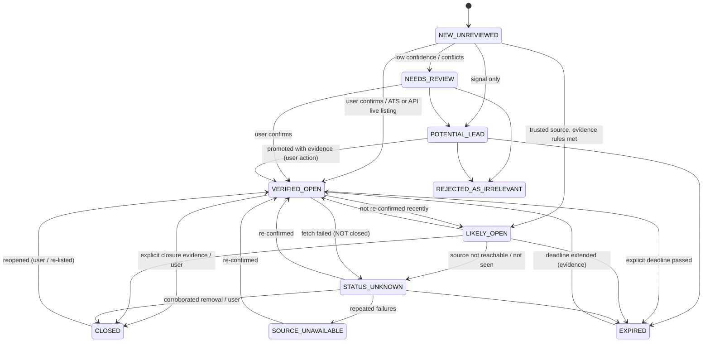
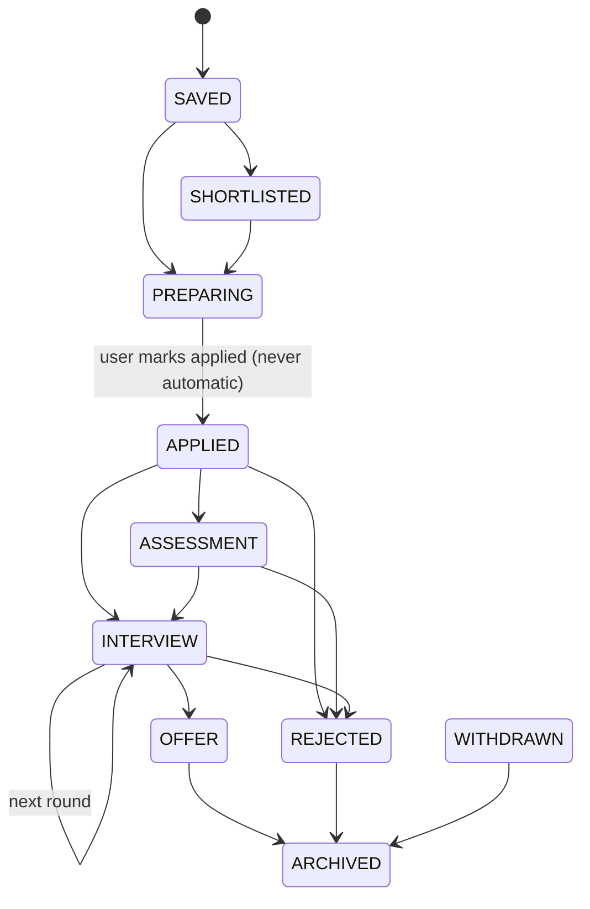
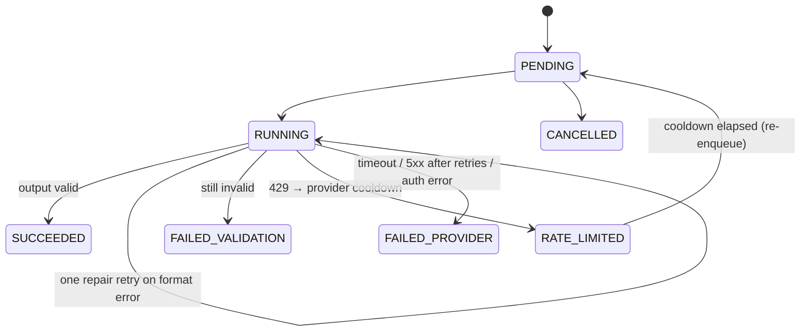

# Unjobless — State Machines

Every transition below is implemented as an explicit table in `backend/src/unjobless/domain/state_machines.py` and unit-tested. Transitions not listed are rejected with `InvalidTransition`. Each machine that matters historically writes a history row (`vacancy_status_history`, `application_status_history`, `source_health_events`).

## 1. Source state and health

Guard: a source can be `ENABLED` only if `policy_status ∈ {APPROVED, RESTRICTED}` and it is not matched by a `source_exclusions` entry. Only `ENABLED` sources are scheduled or run.

Health is derived after each run: `HEALTHY` (success) · `DEGRADED` (partial or 1–2 consecutive failures) · `FAILING` (≥3 consecutive failures) · `RATE_LIMITED` (429/quota; cools down until `next_run_at`) · `UNAVAILABLE` (repeated 403/404/blocked) · `UNKNOWN` (never run).

## 2. Collection job (source run / processing job)

Terminal: `SUCCEEDED`, `PARTIAL`, `FAILED`, `CANCELLED`. At most one non-terminal run per source (partial unique index).

## 3. Import item

Batch status: `PENDING` → `PROCESSING` → `COMPLETED` (all items terminal-ok) or `COMPLETED_WITH_ERRORS`. A failing item never fails the batch.

## 4. Opportunity classification

Classification is an *assignment*, not a lifecycle: each analysis yields one primary + optional secondary classes. Re-classification (new version, user correction) writes a new record; the latest user correction wins over model output.

Routing rule after classification:

| Primary | Creates |
|---|---|
| `DIRECT_VACANCY`, `RECRUITMENT_CAMPAIGN` with explicit role + application path | candidate `job_vacancies` (status `NEW_UNREVIEWED` or `NEEDS_REVIEW`) |
| `INFORMAL_OPPORTUNITY_LEAD`, `REFERRAL_SIGNAL`, `CAREER_PROGRAM`, `RECRUITMENT_CAMPAIGN` (incomplete) | `opportunity_signals` (status `POTENTIAL_LEAD`) |
| `EMPLOYER_DISCUSSION`, `EMPLOYER_REVIEW`, `CAREER_TREND` | sentiment/topic records only |
| `IRRELEVANT` | nothing beyond the raw record |

## 5. Verification status (vacancies and signals)

Hard rules:
- Confidence alone never produces `VERIFIED_OPEN`; it requires (a) user confirmation, or (b) a live listing on an approved API/ATS source.
- A failed fetch moves at most to `STATUS_UNKNOWN`.
- `EXPIRED` requires an **explicit** deadline in the past (evidence-backed); an old publication date alone does not expire a vacancy.
- User corrections are always allowed (any → any) and recorded with `actor=USER`.

## 6. Freshness (derived, recomputed)

`EXPIRED` if status `EXPIRED`/`CLOSED` · `CLOSING_SOON` if explicit deadline within 7 days · `NEW` if first seen < 3 days · `ACTIVE` if last verified < 14 days · `STALE` if last verified ≥ 30 days or never re-checked for 30 days · otherwise `UNKNOWN`. Thresholds live in settings.

## 7. Application status

Any non-terminal state may go to `WITHDRAWN` or `ARCHIVED`. `ARCHIVED` may return to `SAVED` (unarchive). Backward moves (e.g. corrections) are allowed with `actor=USER` and recorded.

## 8. AI task

A failed AI task never writes canonical data.

## 9. Profile version

`DRAFT` (from CV extraction or manual edit) → `CONFIRMED` (user) → `SUPERSEDED` (when a newer version is confirmed). Confirmed versions are immutable; edits create a new `DRAFT`.
